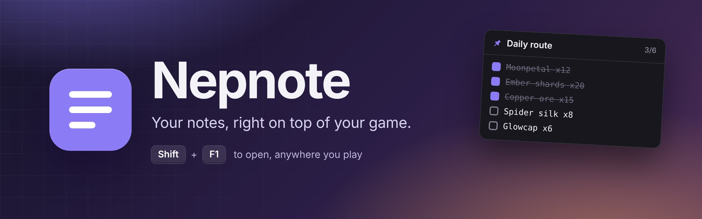
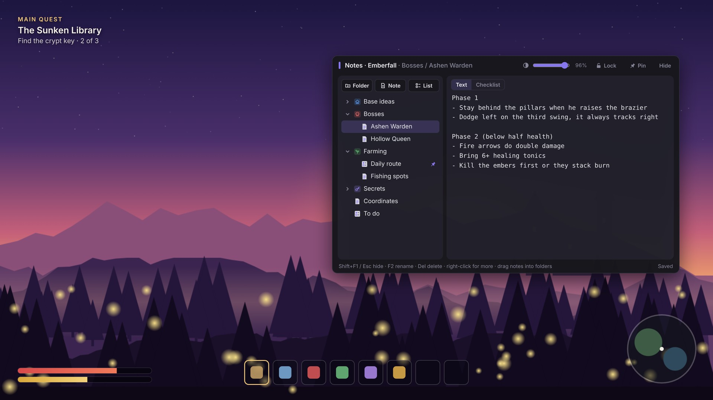
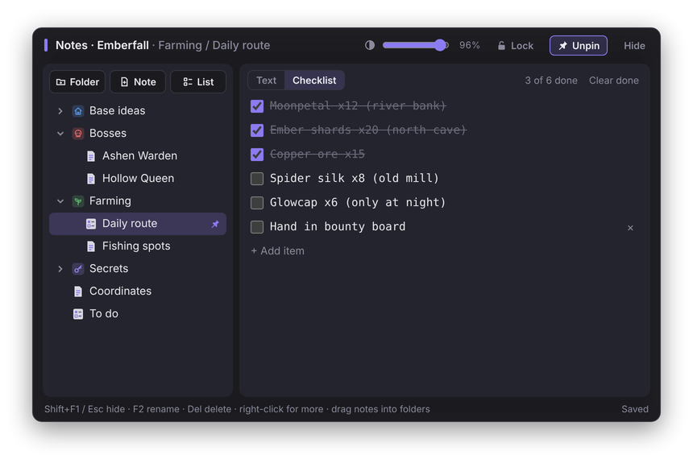
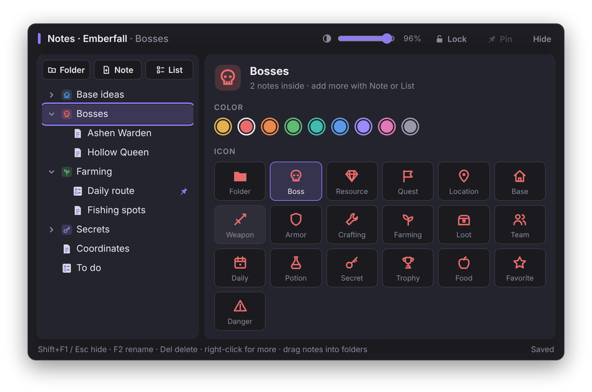
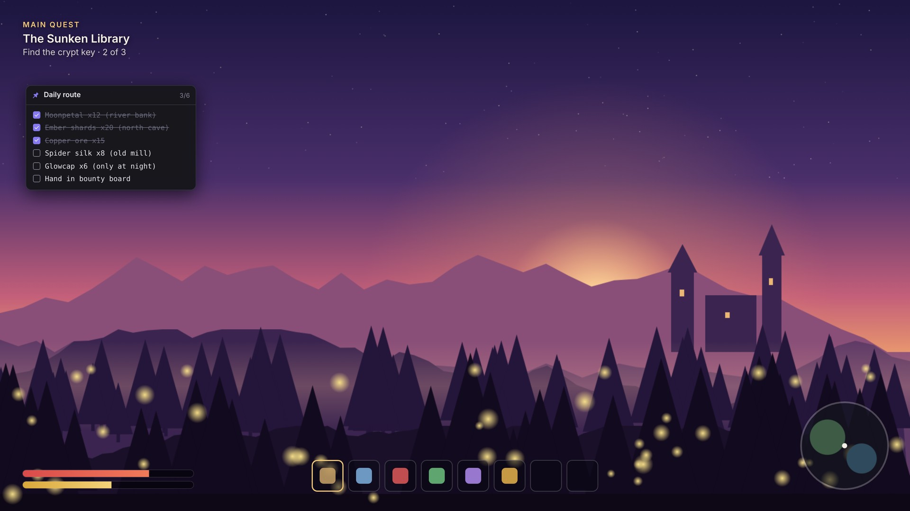

<p align="center">
  
</p>

<p align="center">
  <a href="https://github.com/Doodiez/Nepnote/releases/latest"></a>
  
  
  
</p>

<p align="center">
  <b>Stop alt-tabbing to Notepad.</b><br>
  Press <kbd>Shift</kbd> + <kbd>F1</kbd> in your game and your notes, checklists and boss strategies appear right on top.<br>
  Press it again and they're gone. Your game never loses a beat.
</p>

<p align="center">
  <a href="https://github.com/Doodiez/Nepnote/releases/latest"></a>
  &nbsp;
  <a href="https://github.com/Doodiez/Nepnote/releases/latest/download/Nepnote.exe"></a>
</p>

<br>

<p align="center">
  
</p>

<br>

## ✨ What it does

<table>
  <tr>
    <td width="50%" valign="top">
      
      <h3>☑️ Checklists that keep score</h3>
      Turn any note into a checklist for farming routes, quests or dailies. Tick things off, see <i>3 of 6 done</i> at a glance, and clear finished items in one click.
    </td>
    <td width="50%" valign="top">
      
      <h3>📁 Folders with style</h3>
      Organize notes the way you organize your game. Give each folder a color and one of 19 game icons: Boss, Loot, Quest, Secret and more.
    </td>
  </tr>
</table>

<br>

<p align="center">
  
</p>

<h3 align="center">📌 Pin it and keep playing</h3>
<p align="center">
  Pin a note and it stays on screen as a small card while you play.<br>
  Lock it, and it becomes click-through, so every click still goes to your game.
</p>

<br>

## 🎮 Features

| | |
|---|---|
| ⌨️ **One hotkey** | <kbd>Shift</kbd> + <kbd>F1</kbd> opens and closes your notes. <kbd>Esc</kbd> works too. |
| 🗂️ **A notebook for every game** | Each game gets its own folders and notes, and Nepnote opens the right one for the game you're playing. |
| 📝 **Text or checklist** | Switch any note between plain text and a tickable checklist. |
| 📌 **Pinned card** | Keep one note on screen while you play. It hides when you alt-tab away. |
| 🌫️ **Opacity slider** | Fade the overlay from 35% to 100% to see your game through it. |
| 🔒 **Lock** | Freeze the overlay and card in place so nothing moves by accident. |
| 🎨 **Folder colors and icons** | 9 colors and 19 game-themed icons. |
| 🖱️ **Drag and drop** | Drag notes into folders, rename with <kbd>F2</kbd>, delete with <kbd>Del</kbd>, right-click for more. |
| 🚀 **Start with Windows** | Off by default. Turn it on from the tray menu. |
| 🪶 **Tiny and fast** | A 3 MB app that sits quietly in your tray. |

<br>

## 🚀 Get started in 30 seconds

1. **Download** the [installer](https://github.com/Doodiez/Nepnote/releases/latest) or the [portable `Nepnote.exe`](https://github.com/Doodiez/Nepnote/releases/latest/download/Nepnote.exe) and run it. A purple icon appears in your tray.
2. **Open your game** and press <kbd>Ctrl</kbd> + <kbd>Shift</kbd> + <kbd>F1</kbd>. That adds the game to Nepnote and opens its notebook.
3. **From now on**, press <kbd>Shift</kbd> + <kbd>F1</kbd> in that game whenever you need your notes.

> [!TIP]
> Windows SmartScreen may warn you the first time because Nepnote isn't code-signed. Click **More info** and then **Run anyway**.

> [!NOTE]
> Play in **borderless windowed** mode. Exclusive fullscreen draws over everything, so no overlay can appear on top of it.

<br>

## ⌨️ Shortcuts

| Keys | Where | What it does |
|---|---|---|
| <kbd>Shift</kbd> + <kbd>F1</kbd> | In a listed game | Open or close your notes |
| <kbd>Ctrl</kbd> + <kbd>Shift</kbd> + <kbd>F1</kbd> | In any game | Add this game to Nepnote |
| <kbd>Esc</kbd> | Overlay | Close the overlay |
| <kbd>F2</kbd> | Folder list | Rename |
| <kbd>Del</kbd> | Folder list | Delete (goes to the Recycle Bin) |
| <kbd>Enter</kbd> | Checklist | Add the next item |
| <kbd>Ctrl</kbd> + <kbd>Space</kbd> | Checklist | Tick or untick the current item |

<br>

## 🛡️ Built to stay out of anti-cheat's way

Nepnote is a plain window on top of your game, not a mod. It was designed from the start not to look like a cheat.

- **🔑 Hotkeys only when needed.** <kbd>Shift</kbd> + <kbd>F1</kbd> is a standard Windows hotkey that exists only while one of your games is in front. There's no keyboard hook watching everything you type.
- **🙅 Never touches the game.** Nepnote recognizes games from the Windows process list. It never opens, reads, injects into or draws inside a game.
- **⏸️ Steps aside for anti-cheat.** When Easy Anti-Cheat, BattlEye, FACEIT, EA Javelin, GameGuard, PunkBuster or ACE is running, or a game known to use deep anti-cheat (Valorant, League, Genshin and other HoYoverse games, Fortnite, Apex, CS2 and more), Nepnote releases every hotkey and hides itself until that game closes. Hover the tray icon to see why it paused.
- **👤 No admin rights.** Nepnote refuses to run as administrator.
- **📴 Fully offline.** There's no network code at all, so your notes never leave your PC.

> [!WARNING]
> No tool can promise what a game's rules allow. Check each game's terms, and keep notes outside the game for competitive or ranked play.

<br>

## 📂 Your notes are just files

Everything lives in **`Documents\Nepnote`** as plain `.txt` files. You can open them in Notepad, back them up, or sync the folder with OneDrive or Google Drive.

```
Documents\Nepnote\
├── settings.json          ← your game list and settings
└── Emberfall\
    ├── Bosses\
    │   ├── Ashen Warden.txt
    │   └── Hollow Queen.txt
    ├── Farming\
    │   └── Daily route.txt   ← checklists are text too: [x] done  [ ] to do
    └── To do.txt
```

<details>
<summary><b>⚙️ Settings you can change in <code>settings.json</code></b></summary>
<br>

Open it from the tray menu with **Edit game list and settings**.

```json
{
  "games": ["Emberfall.exe"],
  "blocklist": [],
  "antiCheatProcesses": [],
  "opacity": 96,
  "locked": false
}
```

| Setting | What it does |
|---|---|
| `games` | Games that get the overlay. <kbd>Ctrl</kbd> + <kbd>Shift</kbd> + <kbd>F1</kbd> adds to this for you. |
| `blocklist` | Games where Nepnote should never open, even if they're in `games`. |
| `antiCheatProcesses` | Extra program names that should make Nepnote step aside. |
| `opacity` | Overlay opacity, from 35 to 100. |
| `locked` | Whether the overlay and pinned card are locked in place. |

</details>

<br>

## ❓ FAQ

<details>
<summary><b>The overlay doesn't show up in my game.</b></summary>
<br>
Switch the game to <b>borderless windowed</b> mode, and make sure you added it with <kbd>Ctrl</kbd> + <kbd>Shift</kbd> + <kbd>F1</kbd>. If the tray icon tooltip says Nepnote is paused, an anti-cheat program is running and Nepnote is staying out of its way on purpose.
</details>

<details>
<summary><b>Shift+F1 does nothing in a game that runs as administrator.</b></summary>
<br>
Windows doesn't let normal apps send hotkeys into apps running as admin. Nepnote deliberately never runs as admin, so for those games keep your notes outside the game.
</details>

<details>
<summary><b>Why can't I use it in Valorant, Genshin or CS2?</b></summary>
<br>
Those games use deep anti-cheat, so Nepnote steps aside completely while they're running. That's a safety choice to protect your account.
</details>

<details>
<summary><b>Can I edit my notes outside the game?</b></summary>
<br>
Yes. They're normal text files in <code>Documents\Nepnote</code>, and Nepnote picks up your changes the next time you open the overlay.
</details>

<br>

## 🛠️ Build it yourself

Every push to `main` is built on GitHub Actions and published to [Releases](https://github.com/Doodiez/Nepnote/releases).

To build locally, install [Rust](https://rustup.rs) and [Node.js](https://nodejs.org), then run:

```bash
npm install
npx tauri build
```

The app is in `src-tauri/target/release/nepnote.exe`, and the installer is in `src-tauri/target/release/bundle/nsis/`.

<br>

---

<p align="center">
  <br>
  <sub>Made by <a href="https://github.com/Doodiez">Doodiez</a> · <i>Emberfall</i> in the screenshots is a made-up game.</sub>
</p>
